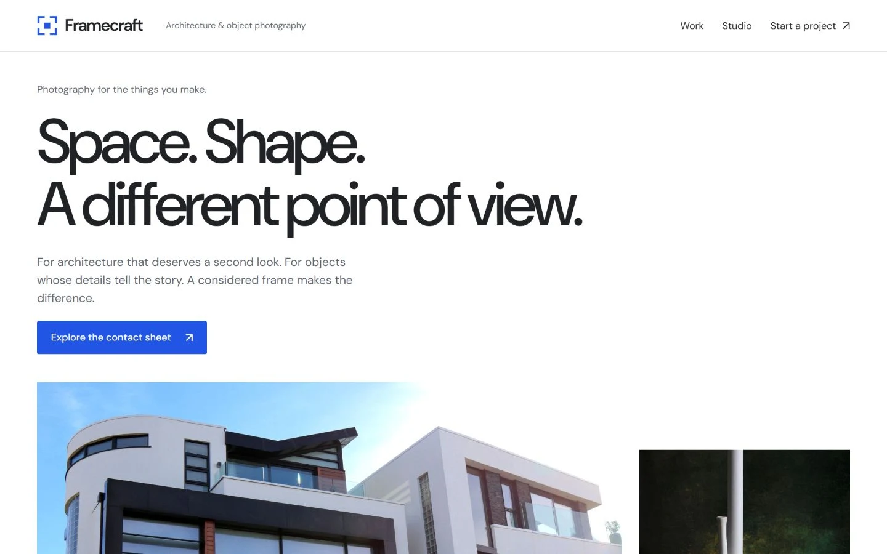

# Framecraft - free photography website template

An architecture and product photography landing page with categorized work, a keyboard-accessible photo viewer and an unsent project enquiry.

[Live preview](https://store.usmankhairdin.com/framecraft/?utm_source=github&utm_medium=referral&utm_campaign=framecraft_open_source) | [Template details and free download](https://store.usmankhairdin.com/templates/framecraft/?utm_source=github&utm_medium=referral&utm_campaign=framecraft_open_source) | [UKD Store](https://store.usmankhairdin.com/?utm_source=github&utm_medium=referral&utm_campaign=framecraft_open_source)

[](https://store.usmankhairdin.com/framecraft/)

## Get started

Choose **Code > Download ZIP**, extract the repository, and open `index.html` in a modern browser. Keep `assets/` beside the HTML file. No framework install, API key or database is required.

For an optional local HTTP preview, run this command inside the extracted folder:

```sh
python -m http.server 4210 --bind 127.0.0.1
```

Then open <http://127.0.0.1:4210/>. Python is one optional preview tool, not a dependency of the website.

## Included features

- Editable HTML, CSS and vanilla JavaScript
- Real work filters and accessible photo-viewer controls
- Architecture/product imagery only, bundled locally
- Responsive navigation and an unsent photography brief

## Make it yours

Edit the content and metadata in `index.html`, styles in `assets/css/framecraft.css`, and interactive data/behaviour in `assets/js/framecraft.js`. Replace the demonstration identity, contact destinations and illustrative claims with your own accurate information. Preserve filenames and relative paths when replacing assets.

The photography brief is an unsent local draft. No message is sent and no shoot is reserved. Stock photographs illustrate the design; they are not commissioned client work.

Connect your own secure backend or service if you need real submissions. Never place private credentials in frontend files.

Upload the supplied files to an ordinary static host or domain subfolder. No build command is needed. Detailed editing, hosting and fallback instructions are in [README.txt](README.txt).

## Licence and asset credits

Template code is distributed under the [MIT licence](LICENSE), including personal and commercial use subject to its notice requirements. Retain the included copyright and licence notices. Fonts, libraries and any stock photography retain their own terms; the MIT code licence does not relicense those assets. See [THIRD_PARTY_NOTICES.txt](THIRD_PARTY_NOTICES.txt) and [licenses/](licenses/).

## More from UKD Store

Browse [premium website and dashboard templates](https://store.usmankhairdin.com/templates/?utm_source=github&utm_medium=referral&utm_campaign=framecraft_open_source), or explore the [free collection](https://store.usmankhairdin.com/collections/free-templates/?utm_source=github&utm_medium=referral&utm_campaign=framecraft_open_source).

Designed & developed by **[Usman Khair Din](https://www.usmankhairdin.com/)**
